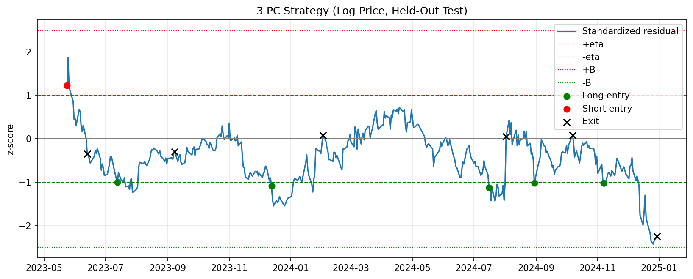
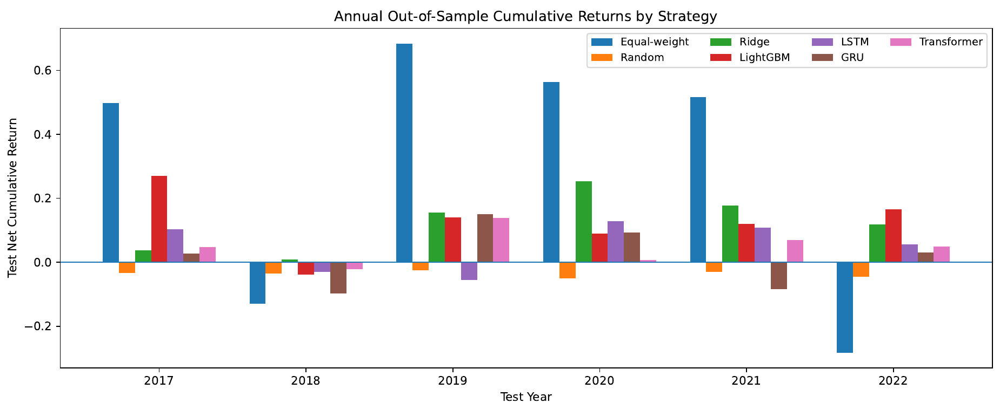
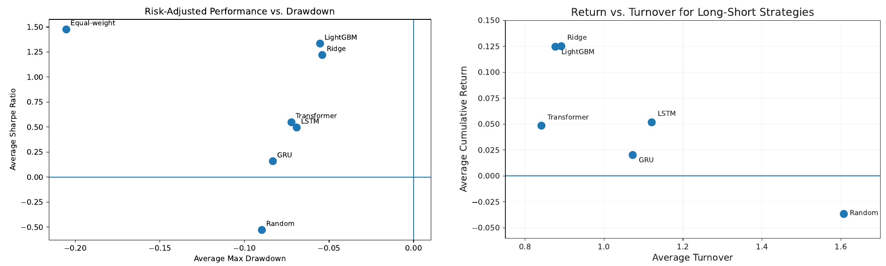

# Relative-Value Trading in Tech & Semiconductor Equities

Can we pull **stock-specific relative-value signals** out of a sector driven by broad market and industry moves? This project tests two approaches:

1. **Time-series convergence:** a PCA-regularized synthetic hedge for **AMD** built from 11 semiconductor stocks. We trade the residual spread.
2. **Cross-sectional prediction:** rank **49 tech stocks** by predicted 5-day relative return using linear, tree-based, and sequence models. Trade a dollar-neutral long/short book.

All model choices are made on validation data under **chronological / walk-forward splits** to avoid look-ahead bias.

> Joint work with **[Xiaowei Zeng](https://github.com/xw-zeng)** (Stanford), Spring 2026.

---

## Key results

**Part I: PCA residual trading (held-out test, 2023-05 → 2024-12)**

| | Log price, 3-PC | Raw price, 2-PC | Direct N-1 OLS |
|---|---:|---:|---:|
| Test R² | **0.264** | −9.05 | −42.0 (log) |
| Trades | 6 | 2 | 0 (residual never re-enters band) |
| Cumulative PnL (gross-normalized) | **+15.93%** | −9.58% | – |
| Win rate | **83%** | 0% | – |
| Max drawdown | −5.1% | −9.6% | – |

Main finding: **PCA alone is not enough; the price transform matters just as much.** Log prices turn multiplicative moves into additive ones (by Itô's lemma). That keeps the residual mean-reverting out of sample, while raw-price residuals drift to −17σ.

**Part II: Cross-sectional ML (walk-forward, test years 2017–2022)**

| Strategy | Avg. return | Avg. Sharpe | Avg. max DD | Positive years |
|---|---:|---:|---:|:---:|
| Equal-weight long-only | 30.9% | 1.48 | −20.5% | 4/6 |
| Random long/short (50 seeds) | −3.7% | −0.53 | −9.0% | 0/6 |
| **Ridge** | **12.5%** | 1.22 | **−5.4%** | **6/6** |
| **LightGBM** | **12.5%** | **1.33** | −5.5% | 5/6 |
| LSTM | 5.2% | 0.50 | −6.9% | 4/6 |
| GRU | 2.0% | 0.16 | −8.3% | 4/6 |
| Transformer | 4.9% | 0.55 | −7.2% | 5/6 |

Main finding: **regularized Ridge and LightGBM beat the sequence models** on noisy short-horizon returns. They also have about ¼ of the drawdown of long-only. The random baseline uses the same portfolio construction and loses money, so the edge comes from the predictions, not the trading rule.

<p align="center"><br>
<sub>Part I: standardized AMD residual on the held-out test set, with entries and exits.</sub></p>

<p align="center"><br>
<sub>Part II: annual out-of-sample returns by strategy, 2017–2022.</sub></p>

<p align="center"></p>

---

## Method

### Part I: PCA-hedged spread

- **Data:** daily adjusted closes (yfinance), 2017-01-03 → 2024-12-30, 2,011 days. Split 60/20/20 chronologically.
- **Model:** standardize hedges on train only → PCA → regress AMD on the first *K* factors → map back to stock-level hedge ratios with β = Aₖᵀγ.
- **Signal:** z-score the residual using train mean/std. Enter at |z| > 1, exit at zero-cross, stop at |z| ≥ 2.5, or exit at max holding period *H*.
- **Selection:** grid over *K* ∈ {2,3,4} and *H* ∈ {20,40,60} on validation PnL. The test set is evaluated once.

### Part II: Cross-sectional ranking

- **Universe:** 49 tech/semiconductor stocks, 2011–2022, 136,529 stock-days, 76 features (multi-horizon returns, volatility, MA/Bollinger, RSI, MACD, volume, cross-sectional ranks).
- **Target:** 5-day forward return minus that day's cross-sectional mean.
- **Protocol:** rolling 5-year train / 1-year validation / 1-year test, repeated over 6 test years.
- **Portfolio:** every 5 trading days, go long the top 20% and short the bottom 20% by predicted return (dollar-neutral). Returns are net of a 5 bp × turnover transaction cost.

## Reproduce

```bash
pip install -r requirements.txt
jupyter lab notebooks/
```

Each notebook downloads its own data from Yahoo Finance, so no data files are needed. Run them in order:

| Notebook | What it does |
|---|---|
| `01_part1_pca_residual_trading.ipynb` | Part I: PCA / N-1 hedges, validation grid search, held-out backtest |
| `02_part2_eda.ipynb` | Part II: universe coverage, target distribution, feature–target correlations |
| `03_part2_walkforward_ridge_lightgbm.ipynb` | Part II: walk-forward pipeline for Ridge, LightGBM, and the equal-weight and random baselines. Writes `rolling5y_*.csv` |
| `04_part2_rolling5y_lightgbm_retrained.ipynb` | Part II: LightGBM retrained on a rolling 5-year window, plus a yearly comparison |
| `05_part2_deep_learning.ipynb` | Part II: LSTM / GRU / Transformer baselines. Reads the CSVs from notebook 03 |

> yfinance data can change slightly over time (e.g. dividend/split adjustments), so re-runs may differ a little from the numbers above.

## Repository layout

```
notebooks/      # analysis notebooks (outputs kept so GitHub renders the figures)
docs/           # figures for this README
```

## Limitations

These are research backtests, not trading advice. Part I PnL is gross of costs and comes from only 6 test trades on one target. Part II uses a simple 5 bp turnover cost and ignores borrow, slippage, and market impact. The universe is a single sector. 

## Acknowledgements

Co-author: **[Xiaowei Zeng](https://github.com/xw-zeng)**. Data from Yahoo Finance via `yfinance`.
